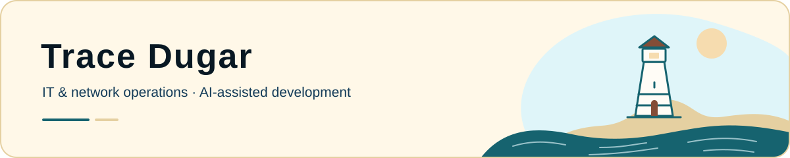

<picture>
  <source media="(prefers-color-scheme: dark)" srcset="assets/banner-dusk.svg">
  <source media="(prefers-color-scheme: light)" srcset="assets/banner-day.svg">
  
</picture>

# Hi, I'm Trace.

I've worked in IT since **September 2023**, across network operations, field support, customer connectivity, and technical documentation. That work taught me to investigate before changing things, protect data, and verify a fix from the user's point of view.

Now I'm applying that same approach to **AI-assisted software development and systems automation**. My background also includes audio engineering and full stack JavaScript training; I enjoy work where the technical details and the experience of using a system both matter.

**[Explore my portfolio](https://traceportfolio.netlify.app/)** · [Project journal](https://github.com/traceadugar/ProjectJournal) · [LinkedIn](https://www.linkedin.com/in/tracedugar/)

## What I'm working on

### TanMar Safety Platform · In progress

AI-assisted modernization of a legacy safety-training application and several smaller HR applications into one bilingual platform. The work includes historical-data migration, access controls, performance, and verification. Core workflows are implemented in the test environment; production hardening continues.

[Read the public case study](https://traceportfolio.netlify.app/case-studies/tanmar-safety-platform) — employer source code and data remain private.

### Aquarium · In progress

A Godot simulation and game built through **prompting alone**. I set the direction, observe behavior, playtest, and critique results; AI agents implement the code and project changes. Alongside making a good game, I'm exploring how durable context, scoped work, and independent review support sustained AI development.

[See the experiment and development evidence](https://traceportfolio.netlify.app/case-studies/aquarium)

### Portfolio recovery & seaside redesign

Recovered my existing React portfolio and reconnected it to my current GitHub and Netlify deployment. Working with Codex, I directed a seaside redesign with English/Japanese content, keyboard-friendly navigation, and synchronized day/dusk lighting that preserves the ocean's motion.

[Visit the site](https://traceportfolio.netlify.app/) · [Explore the source](https://github.com/traceadugar/portfolio)

### Linux ticket practice & RHEL lab

A headless RHEL lab paired with an AI-guided ticket workflow that carries environment state, completed tickets, and learning gaps between sessions. Retained examples show account troubleshooting and a least-privilege correction, with the verification and its limits documented.

[Read the case study](https://traceportfolio.netlify.app/case-studies/linux-ticket-queue) · [Follow the build journal](https://github.com/traceadugar/ProjectJournal/blob/main/March%2026/RHELServer.md) · [View the PaleHorse Bash intro](https://github.com/traceadugar/ProjectJournal/blob/main/April%2026/intoScript/intro.sh)

## My working habits

**Understand → inspect → change → verify → document.**

I use Claude Code, ChatGPT, and Codex for development and learning. I make their role visible, review the results, and keep evidence close to the claims. Aquarium's case study includes an optimization that was rejected after independent AI review; that decision is part of the engineering story too.

| Area | Tools and practices used in my work |
| --- | --- |
| Systems & operations | Linux, RHEL, Bash, PowerShell, SSH, networking, Ubiquiti |
| Applications | Python, FastAPI, PostgreSQL, JavaScript, TypeScript, React, Svelte, Git |
| AI workflow | Prompt and context design, agent coordination, verification and review |
| Security & documentation | Access control, least privilege, technical documentation, security awareness training |

**Credentials:** CompTIA Security+ · Google IT Support · Google Cybersecurity. [Credential details and verification links](https://traceportfolio.netlify.app/about#about).

A little curiosity goes a long way. The shoreline continues on [my portfolio](https://traceportfolio.netlify.app/).
